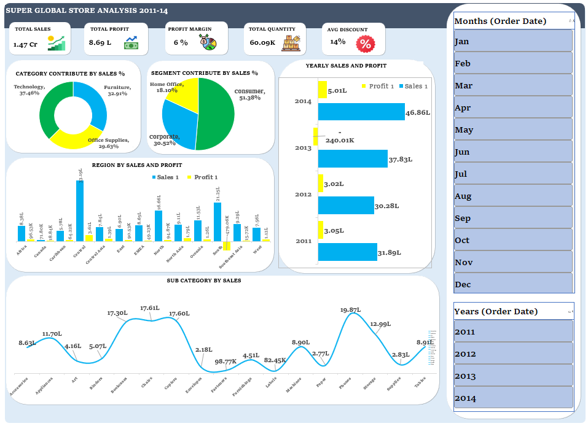

# Global Superstore Sales Analysis Dashboard (2011–2014) 📊

I'm excited to share my Power BI dashboard project focused on analyzing Global Superstore sales data from 2011 to 2014! 🚀

## 📂 Project Files

- **Main Dashboard File:** [View / Download Dashboard](https://github.com/rushikesh-girase-08/Global-Superstore-Sales-Analysis-Dashboard-2011-14-/blob/main/Final%20Dashboard%20(Super%20Global%20Store%20Analysis%202011-14).xlsx)
- **Dataset:** [View Dataset](https://github.com/rushikesh-girase-08/Global-Superstore-Sales-Analysis-Dashboard-2011-14-/blob/main/Super%20Global%20Store%20Data%20(Dataset).xlsx)
- **Dashboard Screenshot:** [View Dashboard Screenshot](https://github.com/rushikesh-girase-08/Global-Superstore-Sales-Analysis-Dashboard-2011-14-/blob/main/Screenshot%202026-11-01%20223120.png)

## 📊 Key Insights at a Glance

✅ Total Sales: 1.47 Cr

✅ Total Profit: 8.69 L

✅ Profit Margin: 6%

✅ Total Quantity Sold: 60.09K

✅ Average Discount: 14%

✅ Category-wise Sales Contribution

✅ Customer Segment-wise Sales Analysis

✅ Yearly Sales and Profit Analysis

✅ Region-wise Sales and Profit Comparison

✅ Subcategory-wise Sales Performance

✅ Interactive Month and Year Filters

## 🛠️ Skills & Tools Used

- Microsoft Power BI
- Microsoft Excel
- Power Query
- Data Cleaning and Transformation
- Data Analysis
- Data Visualization
- KPI Analysis
- Interactive Dashboard Development

## 🎯 Project Objective

The objective of this project is to analyze Global Superstore sales data from 2011 to 2014, identify sales and profit trends, understand category and customer segment performance, and evaluate regional business performance through an interactive dashboard to support data-driven business decisions.

## 🖼️ Dashboard Preview

With interactive visualizations, KPI cards, and month/year filters, this dashboard makes it easier to explore business performance and identify important sales and profitability trends.

## 💡 Key Takeaway

This project helped me strengthen my practical skills in Power BI, Excel, data cleaning, data transformation, business analysis, and interactive dashboard development.

I'm continuously learning and building projects in Data Analytics and Business Intelligence! 🚀

#PowerBI #Excel #DataAnalytics #GlobalSuperstore #Dashboard #DataVisualization #BusinessIntelligence #DataAnalysis
